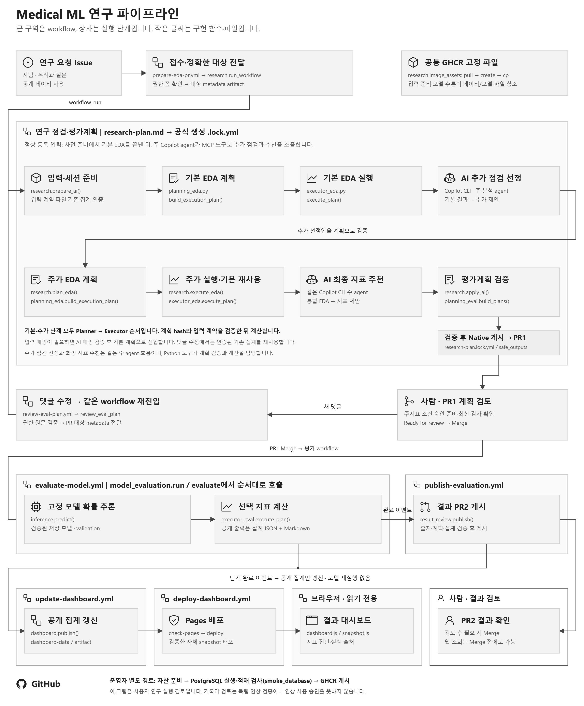

# Medical ML SDLC Workshop

처음 실습하신다면 [단계별 사용자 가이드](instruction.md)를 따라가세요.
저장소 준비부터 댓글 수정, Actions 실행 승인, PR Merge, 대시보드 확인까지 화면 이동 순서대로 설명합니다.

## 워크숍 목적

이 워크숍은 **의료 ML 연구에서 AI의 제안과 연구자의 판단을 평가계획·실행·결과까지 연결해 관리하는 과정**을 경험하는 실습입니다.

준비된 데이터와 모델을 대상으로, 연구 목적에 맞는 점검과 평가 기준을 검토·확정합니다. AI는 준비된 블록에서 점검과 지표를 추천하고, 연구자는 평가계획을 결정합니다. 확정된 계획은 등록된 코드로 실행하고, 결과를 계획·변경 이유·실행 조건과 연결해 확인합니다.

이 과정을 통해 다음과 같은 이점을 살펴봅니다.

- **간편화·가속화:** 점검·평가·결과 정리 절차를 매번 직접 구현하지 않고, 준비된 블록과 자동 실행을 활용해 반복 작업을 줄이고 평가 결과를 더 빠르게 확인합니다.
- **일관성·재현성:** AI가 매번 새로운 계산 코드를 만드는 대신, 같은 평가 코드와 고정된 데이터·모델을 사용합니다. 계산 방식과 버전 혼동을 줄이고, 같은 조건으로 결과를 비교·재현합니다.
- **기록·추적:** 연구 목적부터 계획·변경 이유·승인·실행 결과까지 한 흐름으로 남깁니다. 어떤 판단과 조건에서 나온 결과인지 확인하고, 동료와 공유·재검토합니다.

실습은 별도의 코드 작성 없이 **GitHub 웹에서 진행합니다.**

## 파이프라인

[](docs/images/pipeline.svg)

큰 구역은 workflow, 상자는 그 안의 실행 단계입니다.
기본 EDA와 추가 EDA는 각각 **Planner → Executor**를 거치며, `research-plan.md`가 이 과정을 포함합니다.
[실제 함수·호출 위치와 순서 근거](docs/images/pipeline-source.json)

| 단계 | 워크플로 | 트리거 | 산출물 |
|---|---|---|---|
| 1. 접수 | `prepare-eda-pr.yml` | 연구 요청 이슈 등록 · 수동 | 권한과 폼을 확인한 정확한 분석 대상 |
| 2. EDA·계획 | `research-plan.md` | 접수 완료 · 수동 | 기본·추가 EDA, 평가계획, 첫 draft PR1 |
| 3. 계획 수정 | `review-eval-plan.yml` → `research-plan.md` | PR1에 자연어 댓글 | 같은 PR의 선택·계획·보고서 갱신 |
| 4. 추론·평가 | `evaluate-model.yml` | PR1 Merge · 수동 | `evaluation.json`, `report.md`, Actions Summary |
| 5. 결과 검토 | `publish-evaluation.yml` | 평가 성공 | 집계 결과 두 파일의 draft PR2 |
| 6. 화면 갱신 | `update-dashboard.yml` | 관련 실행 완료 · 수동 | `dashboard-data` 브랜치와 대시보드 artifact |
| 7. 웹에서 보기 | `deploy-dashboard.yml` | 대시보드 갱신 성공 · 화면 코드 변경 · 수동 | 공개 실습 저장소의 실제 결과 Pages |

### 1. 접수

`연구 요청` 이슈 폼에 연구 목표, 질문, 분석 대상과 추가 요청을 남깁니다.
같은 저장소에 쓰기 권한이 있는 사람의 요청만 처리하며, 폼과 공개 데이터 사용 확인을 검사합니다.
이 단계는 대상을 전달할 뿐 모델을 실행하지 않습니다.

### 2. EDA·계획

기본 EDA를 먼저 계산합니다. Copilot은 그 집계를 읽고 **아직 실행하지 않은 점검만** 추가로 제안합니다.
등록된 Python 블록이 추가 점검을 실행한 뒤, 전체 EDA를 근거로 평가 지표를 추천하고 첫 PR1을 만듭니다.

점검은 스키마·환자 중복·인구통계·코호트·예측 시점·라벨 관찰가능성·전처리 계보의 7개 블록으로 구성합니다.
평가 지표는 별도 카탈로그의 15개 블록에서 선택합니다.
자료가 부족한 항목을 통과로 바꾸거나 임상적 의미를 추측하지 않습니다.

### 3. 계획 수정

PR1에 평소 문장으로 요청을 남기면 Actions의 **GitHub Copilot CLI**가 해석하고 같은 PR에 반영합니다.
별도의 `/plan` 명령이나 `@copilot` 멘션은 필요하지 않습니다. Cloud agent로 댓글 처리를 바꾸지는 않았습니다.

지표나 threshold만 바뀌면 검증된 EDA를 재사용합니다. 새 점검이 필요한 경우에만 해당 블록을 계산합니다.
Python은 허용된 ID·값·입출력 계약을 확인하며, 댓글을 코드로 실행하지 않습니다.

다음은 교육용 연결 검증에 사용한 요청 형태입니다.

> 기존 EDA는 유지하고 F1·Recall·Precision을 추가해 주세요. 주지표는 AP로 하고,
> threshold는 교육용 데모 값 0.5를 사용해 주세요. 새로 계산한 점검과 재사용한 점검을 구분해 알려주세요.

`0.5`는 임상 표준이나 최적값이 아닙니다. 필요한 값이 빠졌다면 차단·대기 사유를 남깁니다.
현재 지시문은 AI가 사람 대신 주지표·임계값·임상 행동을 확정하지 못하게 합니다.
실행이 성공했더라도 요청한 선택과 값이 실제 계획에 들어갔는지 확인해야 합니다.

### 4. 추론·평가

연구자가 PR1을 Merge하면 저장된 계획을 계약으로 삼아 고정 모델을 실행합니다.
데이터·모델의 digest, 파일 hash, 특성 이름과 순서, 클래스와 행 연결을 검사한 뒤 `predict_proba`를 호출합니다.
평가 지표는 기존 Python Executor가 계산합니다.

자동 평가는 **validation 15,265행**만 사용합니다. test는 정확한 Merge PR을 지정한 수동 실행에서만 선택할 수 있습니다.
모델 저장 환경에 맞춰 **Python 3.11 / scikit-learn 1.2.2**를 사용하며 추가 scaler나 학습을 적용하지 않습니다.
계획 당시의 코드·자산·입력 계약과 현재 실행이 다르면 멈춥니다.

산출물은 집계 JSON과 Markdown 보고서 두 개입니다. 환자별 확률·정답·키·특성 벡터는 게시하지 않습니다.
**EDA의 `failed`는 점검 기준 위반을 뜻하며 추론 프로그램의 실패와는 별개입니다.**

### 5. 결과 검토

별도 publisher가 정확한 평가 workflow의 성공·run/attempt·artifact 출처를 확인하고 draft PR2를 만듭니다.
저장된 계획·데이터·모델·집계가 서로 맞는지 다시 검사하며, 모델이나 지표를 재실행하지 않습니다.

같은 결과를 재게시하면 기존 PR을 재사용하고 불필요한 커밋을 만들지 않습니다.
사람이 쓴 제목·메모·검토 상태를 보존하며, 닫히거나 Merge된 결과 PR을 임의로 다시 열지 않습니다.
이 검사는 다른 AI 모델의 독립 검증이나 임상 성능 인증을 뜻하지 않습니다.

### 6. 화면 갱신

대시보드는 Target·EDA·Evaluation Plan·Model·Evaluation·Result의 6개 화면으로 구성합니다.
Issue 접수, PR1 게시·수정, 실제 평가, PR2 게시가 완료될 때 공개 집계를 받아 채웁니다.

새 Issue는 이전 Issue의 평가 결과와 섞지 않습니다.
Issue별 스냅샷을 따로 보관하고, 이전 실행의 늦은 완료가 새 Issue의 화면을 덮어쓰지 않게 합니다.
Evaluation에는 계산된 지표를, Result에는 전체 지표와 실제 calibration 집계를 표시합니다.
좌표가 없는 ROC·PR 곡선이나 산출하지 않은 하위집단 성능을 가짜 그래프로 채우지 않습니다.

공개 저장소용 화면은 토큰 없이 공개 스냅샷을 처음 열 때와 60초 간격으로 읽습니다.
조회가 실패하면 마지막 정상 집계와 오류 상태를 표시하며, 모델 실행이나 PR 승인 기능은 제공하지 않습니다.
비공개 저장소는 Actions artifact에 포함된 오프라인 집계를 사용합니다.

### 데이터와 해석 범위

| 항목 | 현재 기준 |
|---|---|
| 데이터 | 공개 Diabetes 입원 데이터. train 71,236 / validation 15,265 / test 15,265행 |
| 입력·모델 | 이미 준비된 113개 숫자 특성과 대응 LogisticRegression |
| 정답 | 30일 이내 재입원 `<30`은 1, `>30`·`NO`는 0 |
| 고정 참조 | [`config/assets.json`](config/assets.json)의 공통 데이터·모델 digest |
| 출처·라이선스 | [`data/NOTICE.txt`](data/NOTICE.txt), [`config/prepared-source.json`](config/prepared-source.json) |
| 임상 사용 | 입력의 임상적 의미·예측 시점·추적 완전성과 실제 활용 적합성은 별도 검토가 필요합니다 |

## 구성

```text
.
├── instruction.md                     # 참가자용 단계별 웹 실습 안내
├── .github/
│   ├── ISSUE_TEMPLATE/research-request.yml
│   └── workflows/
│       ├── prepare-eda-pr.yml          # 연구 요청 접수
│       ├── research-plan.md           # Copilot의 EDA·계획 조율
│       ├── research-plan.lock.yml     # 공식 compiler 생성 결과
│       ├── review-eval-plan.yml       # 자연어 댓글 접수
│       ├── evaluate-model.yml         # Merge된 계획의 실제 추론·평가
│       ├── publish-evaluation.yml     # 집계 결과 PR2
│       ├── update-dashboard.yml       # 단계별 스냅샷·artifact 갱신
│       ├── deploy-template-preview.yml # 원본 전용 빈 Pages 데모
│       ├── deploy-dashboard.yml       # 실습 저장소의 실제 결과 Pages
│       ├── ci.yml                     # 코드와 계약 회귀 검사
│       └── publish-db-image.yml       # 운영자용 공통 자산 게시
├── app/
│   ├── research.py                    # 공통 Controller·실행 세션·게시 연결
│   ├── planning_eda.py                # EDA 계획과 입력 계약
│   ├── executor_eda.py                # 등록 EDA 실행·집계·재사용
│   ├── planning_eval.py               # 평가 지표·매개변수 계획
│   ├── executor_eval.py               # 등록 지표 계산
│   ├── inference.py                   # 고정 모델 검증·확률 추론
│   ├── model_evaluation.py            # Merge 계획과 추론·평가 연결
│   ├── result_review.py               # 검증한 집계의 PR2 게시
│   └── dashboard.py                   # 집계 검증·화면 데이터 게시
├── config/                            # 고정 자산·블록 카탈로그·계획 정책
├── dashboard/                         # 6단계 빈 화면·로컬 차트·OSS 라이선스
├── research/
│   ├── reports/issue-{issue}/          # PR1의 EDA·선택·평가계획
│   └── results/issue-{issue}/{split}/  # PR2의 evaluation.json·report.md
├── docs/                              # 아키텍처·결정 기록·구현 범위
└── tests/                             # 합성 계약·단계별 연결·회귀 검사
```

### 주의

이 샘플은 의료 ML의 연구·검토 과정을 실습하기 위해 준비했습니다. 실제 진료나 임상 의사결정에 사용하지 마세요.
실행이 성공하거나 결과 PR이 만들어져도 모델의 임상적 유효성이 검증된 것은 아닙니다.

이미 전처리·분할된 공개 Diabetes 데이터와 대응 모델을 사용합니다. 새 학습·전처리·재분할은 하지 않습니다.
환자 중복과 validation의 개발 사용 이력이 있으므로 독립 검증 성능으로 해석할 수 없습니다.

연구자가 GitHub 이슈에 목적과 질문을 남기면, 기본 EDA를 먼저 실행하고 Copilot이 추가로 볼 점검과 평가 지표를 제안합니다.
연구자는 PR과 댓글에서 분석 범위를 조정하고 계획을 승인합니다. 승인된 계획으로 고정 모델을 평가한 뒤 결과를 별도 PR에서 검토합니다.

**Copilot은 제안과 자연어 해석을, Python은 계약 검증과 실제 계산을 담당합니다.**
무엇을 계산했는지, 무엇을 재사용했는지, 무엇은 확인할 수 없는지를 함께 남깁니다.
대시보드에서는 단계별 집계와 평가 결과, 실행 출처를 확인합니다.

**모든 산출물은 교육·연구용이며, 임상 사용 전 별도의 데이터·모델 검증과 전문가 검토가 필요합니다.**
